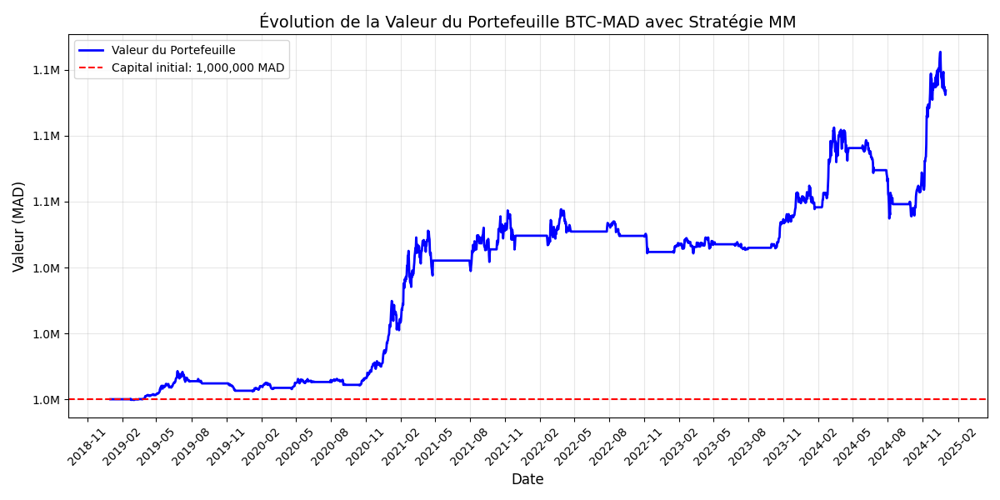
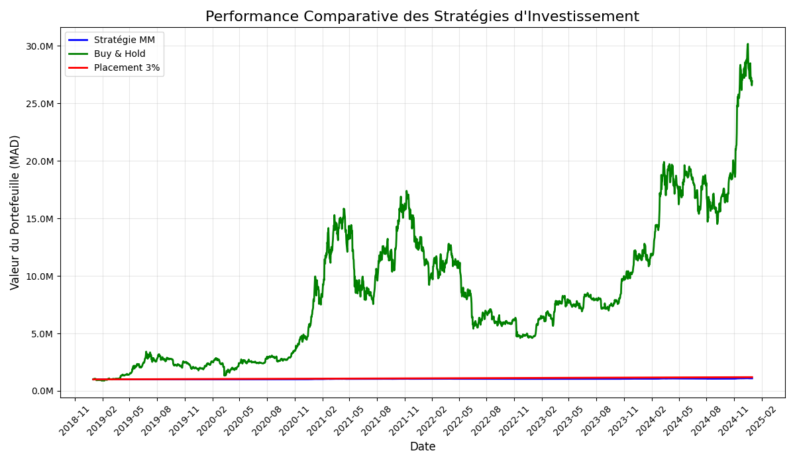
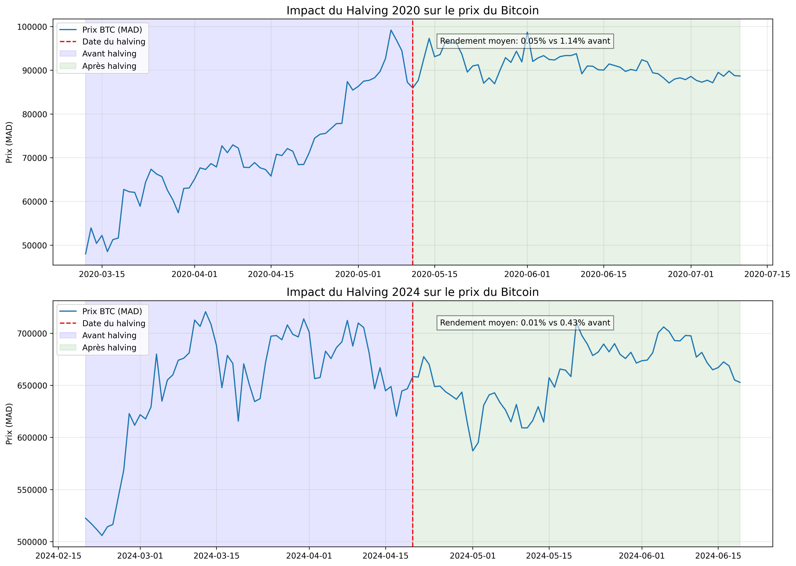

# 🪙 Bitcoin Analytics — BTC/MAD (2019 — 2025+)

[](https://python.org)
[](https://streamlit.io)
[](https://plotly.com)
[](https://www.docker.com/)
[](https://github.com/BozIAymane/Analyse-Bitcoin-BTC-MAD/actions)
[](license.md)

> **Projet Complet d'Analyse Quantitative, Économétrique et de Simulation d'Investissement du Bitcoin en Dirham Marocain (MAD).**  
> Ce dépôt regroupe à la fois :
> 1. 📜 **L'Étude Historique Approfondie (2019–2025)** : Script complet en 12 parties, tests économétriques avancés, 15+ visualisations de recherche, et application de bureau dédiée.
> 2. 🚀 **La Plateforme Interactive v2.0** : Moteur de backtest modulaire sans biais d'anticipation avec prise en compte des frais de trading, simulateur DCA en MAD, tableau de bord web **Streamlit** en temps réel, et conteneurisation Docker.

---

## 🧭 Sommaire

- [🌟 Vue d'Ensemble des Deux Volets](#-vue-densemble-des-deux-volets)
- [📜 Volet 1 : L'Étude Historique Complète (2019–2025)](#-volet-1--létude-historique-complète-20192025)
  - [Statistiques Descriptives & Tests](#statistiques-descriptives--tests-statistiques)
  - [Comparaison des Stratégies Classiques](#comparaison-des-stratégies-historiques-capital--1-000-000-mad)
  - [Impact des Halvings & Contexte de Marché](#impact-des-halvings--optimisation-des-paramètres)
  - [Galerie des Résultats de Recherche](#galerie-des-résultats-de-recherche)
- [🚀 Volet 2 : La Plateforme Interactive & Moteur Quantitatif v2.0](#-volet-2--la-plateforme-interactive--moteur-quantitatif-v20)
  - [Nouveautés & Améliorations Quantitatives](#nouveautés--améliorations-quantitatives)
  - [Architecture Modulaire du Code](#architecture-modulaire-du-code)
  - [Résultats du Moteur de Backtest Réaliste](#résultats-du-moteur-de-backtest-réaliste-v20)
- [⚡ Guide de Lancement Rapide](#-guide-de-lancement-rapide)
- [🛠️ Stack Technologique](#️-stack-technologique)
- [👤 Auteur & Licence](#-auteur--licence)

---

## 🌟 Vue d'Ensemble des Deux Volets

| Fonctionnalité | Volet 1 : Recherche Historique (2019-2025) | Volet 2 : Plateforme v2.0 (Streamlit & Live) |
| :--- | :--- | :--- |
| **Période d'analyse** | 01/01/2019 au 01/01/2025 (Période fixe de 6 ans) | 2019 jusqu'à aujourd'hui (Mise à jour en temps réel) |
| **Taux de change MAD** | Taux fixe d'étude (10.8 EUR/MAD) | **Taux dynamique quotidien USD/MAD** via Yahoo Finance |
| **Interface Utilisateur** | Application de bureau Tkinter (`appbtc.py`) | **Dashboard Web moderne Streamlit** (`app.py`) |
| **Exécution des ordres** | Signal et clôture sur la même barre | **Zéro Look-Ahead Bias** (Exécution à $t+1$ à l'Open) |
| **Frais de transaction** | 0% (Modèle théorique pur) | **Frais réels paramétrables** (0.1% par trade par défaut) |
| **Stratégies testées** | Buy & Hold, MM20/50, Stop-Loss | MM (paramétrable), Buy & Hold, **DCA en MAD**, Sans Risque |
| **DevOps / CI** | Exécution manuelle en console | **Docker Compose** + **GitHub Actions CI** automatique |

---

## 📜 Volet 1 : L'Étude Historique Complète (2019–2025)

L'étude historique a analysé **2 192 observations quotidiennes** du cours du Bitcoin pour comprendre le profil de risque et évaluer l'efficacité des stratégies systématiques.

### Statistiques Descriptives & Tests Statistiques

| Métrique / Test | Valeur Historique | Interprétation |
| :--- | :---: | :--- |
| **Rendement Moyen Quotidien** | `+0.207%` | Tendance de fond haussière du Bitcoin sur le long terme. |
| **Écart-Type Quotidien** | `3.36%` | Très forte dispersion traduisant la volatilité de l'actif. |
| **Skewness (Asymétrie)** | `-0.259` | Distribution asymétrique avec risque de pertes extrêmes plus prononcé. |
| **Kurtosis (Aplatissement)** | `10.12` | Caractère leptokurtique confirmant la présence de **queues épaisses** (*fat tails*). |
| **Shapiro-Wilk & Jarque-Bera** | `p < 0.05` | ❌ **Rejet strict de la normalité** (La loi normale sous-estime les krachs). |
| **Test ADF (Stationnarité)** | `p < 0.05` | ✅ **Série stationnaire** des rendements (absence de racine unitaire). |
| **Test ARCH d'Engle** | `p < 0.05` | ✅ Présence confirmée de **clusters de volatilité** (hétéroscédasticité conditionnelle). |

### Comparaison des Stratégies Historiques (Capital : 1 000 000 MAD)

| Stratégie | Rendement Total | Volatilité Annuelle | Ratio de Sharpe | Drawdown Maximum |
| :--- | :---: | :---: | :---: | :---: |
| **Buy & Hold (Achat & Conservation)** | **+2,591.8%** | 64.2% | 1.09 | **-73.57%** |
| **Moyennes Mobiles (MM20/MM50)** | **+9.1%** à **+1,897.4%** | 39.6% | 1.07 | **-2.56%** à **-38.4%** |
| **Placement Sans Risque (Taux BAM 3%)** | **+19.4%** | 0.0% | 0.00 | 0.00% |

### Impact des Halvings & Optimisation des Paramètres

- **Halving de Mai 2020** : Rendement moyen 60j avant (+1.14%) vs 60j après (+0.05%) avec chute de volatilité de 81.4% à 38.9%.
- **Halving d'Avril 2024** : Rendement moyen 60j avant (+0.43%) vs 60j après (+0.02%) avec baisse de volatilité de 57.9% à 36.6%.
- **Combinaison optimale MM** : La combinaison **MM10 / MM30** a produit le meilleur ratio de Sharpe (**1.08**) avec un rendement cumulé de **+1,943.6%** sur 82 transactions.

### Galerie des Résultats de Recherche

Les graphiques générés lors de l'étude sont archivés dans le dossier [`results/`](results/) :

| Évolution du Portefeuille | Comparaison des Stratégies | Impact des Halvings |
| :---: | :---: | :---: |
|  |  |  |

*(Voir aussi [`executive_summary.md`](executive_summary.md) pour la synthèse détaillée).*

---

## 🚀 Volet 2 : La Plateforme Interactive & Moteur Quantitatif v2.0

La version 2.0 modernise le projet pour répondre aux standards de l'ingénierie financière et du développement logiciel moderne.

### Nouveautés & Améliorations Quantitatives
1. **Annualisation Crypto sur 365 Jours** : Contrairement aux actions qui ne cotent que 252 jours par an, le Bitcoin s'échange 24h/24 et 7j/7. Les ratios de Sharpe et volatilités utilisent rigoureusement $\sqrt{365}$.
2. **Élimination du Look-Ahead Bias** : Les signaux calculés à la clôture du jour $t$ sont désormais exécutés au prix d'ouverture du jour $t+1$.
3. **Frais de Trading Intégrés** : Application de commissions paramétrables (0.1% par trade) simulant les frais réels sur Binance ou Kraken.
4. **Simulateur Dollar-Cost Averaging (DCA en MAD)** : Permet de simuler un investissement mensuel régulier (ex: 1 000 MAD chaque mois) pour lisser les points d'entrée.

### Architecture Modulaire du Code

```text
Analyse-Bitcoin-BTC-MAD/
├── .github/workflows/ci.yml       # Intégration continue GitHub Actions
├── src/
│   ├── __init__.py
│   ├── data_loader.py             # Téléchargement BTC-USD + USDMAD=X avec cache local
│   ├── indicators.py              # SMA, EMA, RSI, MACD, Bandes de Bollinger, Volatilité
│   ├── statistics.py              # Tests ADF, Shapiro, Jarque-Bera, ARCH, Saisonnalité
│   └── backtest.py                # Moteur de simulation quantitatif réaliste & DCA
├── app.py                         # Application Web Interactive Streamlit
├── appbtc.py                      # Application historique de bureau (Tkinter)
├── bitcoin_full_scripts.py        # Script historique complet d'analyse (1080+ lignes)
├── BTC_data.csv                   # Cache local des données historiques
├── results/                       # 15+ visualisations générées de l'étude
├── Dockerfile                     # Image Docker de l'application
├── docker-compose.yml             # Déploiement multi-conteneur
├── requirements.txt               # Dépendances Python
└── README.md
```

### Résultats du Moteur de Backtest Réaliste (v2.0)

Calculé avec capital initial de **1 000 000 MAD**, frais de trading de **0.1%**, taux sans risque de **3.0%**, et exécution à $t+1$ :

| Métrique | Stratégie MM20 / MM50 | Buy & Hold (Achat & Conservation) | Placement Sans Risque (3%) |
| :--- | :---: | :---: | :---: |
| **Capital Final (MAD)** | **21 720 577 MAD** | **26 918 100 MAD** | **1 194 200 MAD** |
| **Rendement Total** | **+2 072.1%** | **+2 591.8%** | **+19.4%** |
| **CAGR Annuel** | **+67.0%** | **+73.8%** | **+3.0%** |
| **Volatilité Annualisée (365j)** | **46.1%** | **64.2%** | **0.0%** |
| **Ratio de Sharpe (Rf = 3%)** | **1.34** | **1.09** | **0.00** |
| **Drawdown Maximum** | **-48.6%** *(Protection accrue)* | **-73.6%** *(Exposition totale)* | **0.0%** |
| **Nombre de Trades & Win Rate** | **19 trades (57.9% gagnants)** | **1 trade** | **0 trade** |

---

## ⚡ Guide de Lancement Rapide

### 1. Lancer l'Application Web Streamlit (Recommandé)

```bash
# 1. Cloner le dépôt
git clone https://github.com/BozIAymane/Analyse-Bitcoin-BTC-MAD.git
cd Analyse-Bitcoin-BTC-MAD

# 2. Créer l'environnement virtuel et l'activer
python -m venv venv
venv\Scripts\activate      # Windows
# source venv/bin/activate  # Linux / macOS

# 3. Installer les dépendances
pip install -r requirements.txt

# 4. Lancer le dashboard web
streamlit run app.py
```
👉 Accédez à l'interface sur : `http://localhost:8501`.

---

### 2. Lancer avec Docker

```bash
docker compose up -d --build
```
L'application est disponible immédiatement sur `http://localhost:8501`.

---

### 3. Exécuter les Scripts Historiques du Volet 1

- **Lancer l'analyse complète historique en console** :
  ```bash
  python bitcoin_full_scripts.py
  ```
- **Lancer l'interface de bureau historique (Tkinter)** :
  ```bash
  python appbtc.py
  ```

---

## 🛠️ Stack Technologique

- **Langage** : Python 3.10+
- **Ingénierie des Données** : `yfinance`, `pandas`, `numpy`
- **Modélisation Économétrique & Statistique** : `scipy`, `statsmodels`
- **Visualisations & Web** : `streamlit`, `plotly`, `matplotlib`, `seaborn`
- **DevOps & Intégration Continue** : `Docker`, `docker-compose`, `GitHub Actions`

---

## 👤 Auteur & Licence

- **Auteur** : [Aymane Bozian](https://github.com/BozIAymane)
- **Licence** : Ce projet est sous licence MIT — voir le fichier [`license.md`](license.md) pour plus de détails.
